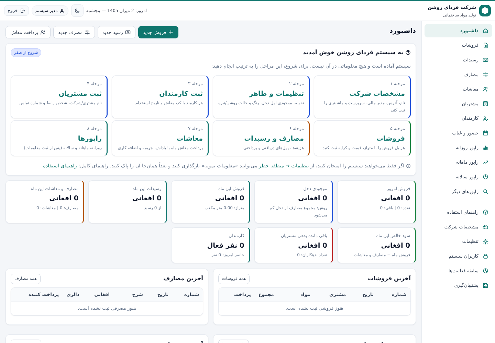
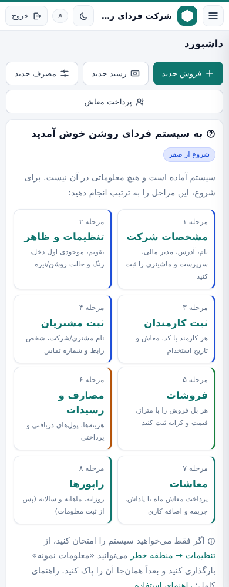
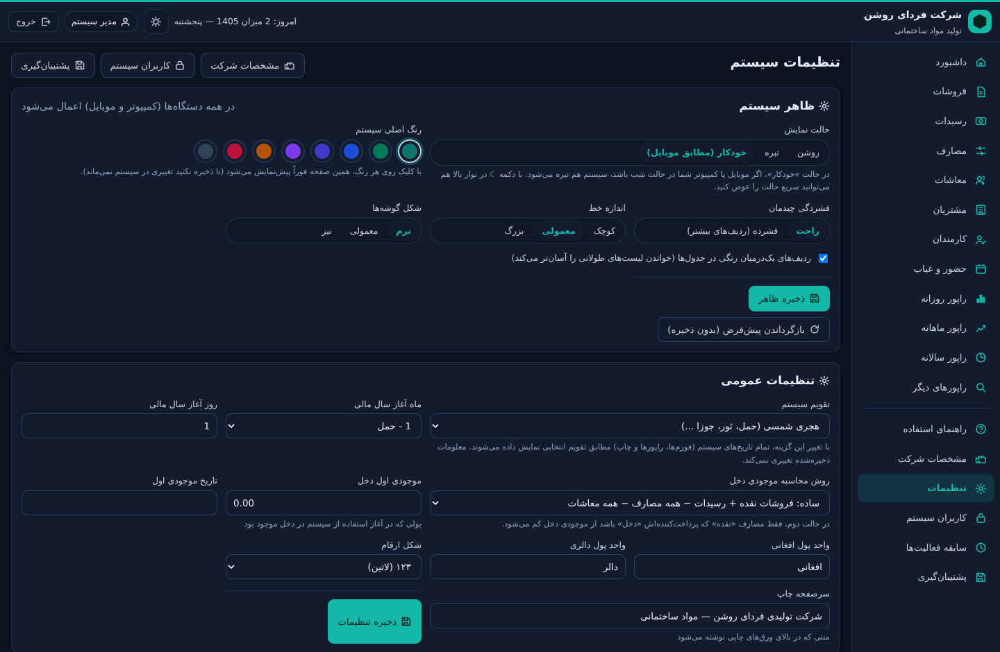
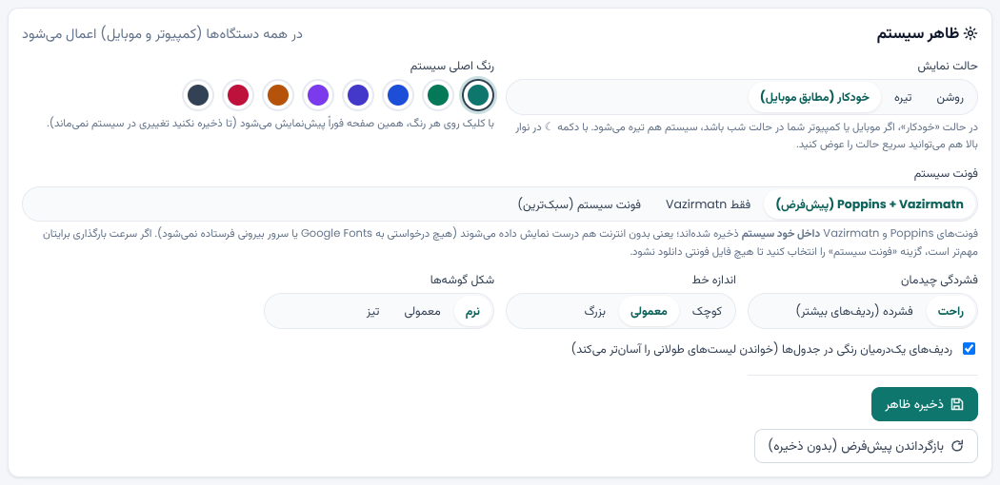
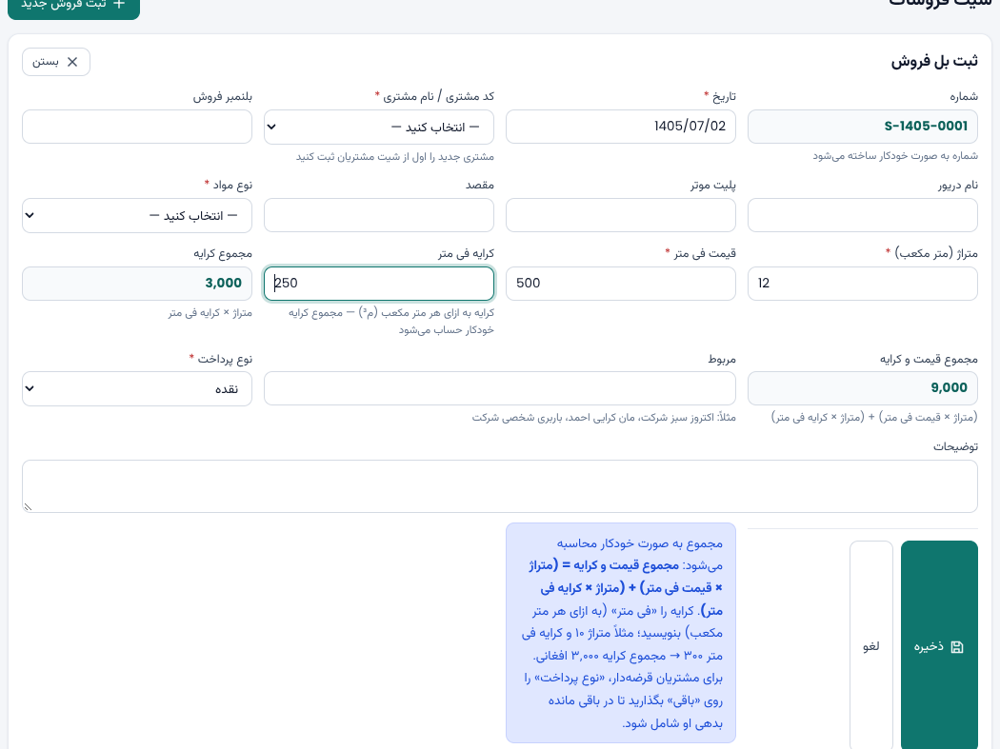
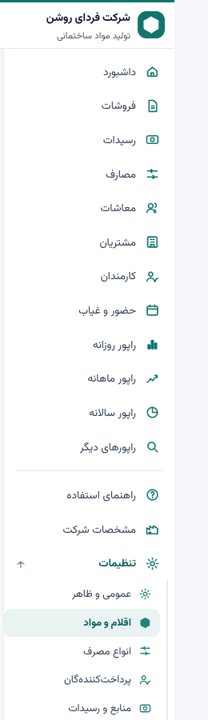
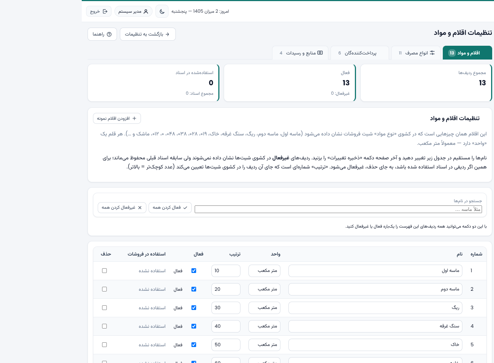
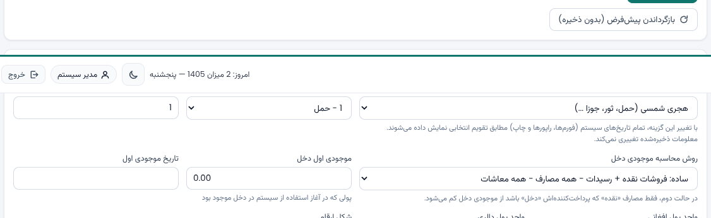

# 🧱 سیستم مدیریت شرکت تولیدی فردای روشن (مواد ساختمانی)

سیستم مدیریت داخلی شرکت — با **PHP** و **MySQL / MariaDB** نوشته شده و **کاملاً محلی (Local)** کار می‌کند؛
هیچ نیازی به انترنت ندارد. تمام شیت‌های درخواستی (مشخصات شرکت، کارمندان، حضور و غیاب، فروشات، مشتریان،
مصارف، رسیدات، معاشات و راپورهای روزانه/ماهانه/سالانه) در این سیستم موجود است.

---

## ۱) شیت‌ها و امکانات

| شیت | محتوا |
|---|---|
| **مشخصات شرکت** (ثابت) | نام، نوع فعالیت، آدرس، سال مالی، مدیر مالی، سرپرست، تعداد کارمندان، **انواع و تعداد ماشینری** |
| **کارمندان** (۲۰ نفر) | شماره، کد کارمند، نام، نام پدر، وظیفه، تاریخ استخدام، معاش ثابت، شماره تماس، شماره تذکره، آدرس، مدت قرارداد، وضعیت (فعال/غیرفعال)، توضیحات |
| **حضور و غیاب** | ورق روزانه (حاضر/غایب/رخصت/مریض/رخصتی رسمی/جمعه + ساعت ورود و خروج + اضافه کاری)، نمای ماهانه گرافیکی، راپور خلاصه |
| **فروشات** | شماره، تاریخ، کد مشتری، بلنمبر فروش، نام مشتری، نام دریور، پلیت موتر، مقصد، نوع مواد (کشویی)، متراژ (متر مکعب)، قیمت فی متر، **کرایه فی متر**، **مجموع کرایه**، مجموع قیمت و کرایه، مربوط، نوع پرداخت (نقده/باقی)، توضیحات |
| **مشتریان** | شماره، کد مشتری، نام مشتری/شرکت، شخص رابط، شماره تماس، پلیت موتر، **باقی مانده بدهی**، توضیحات |
| **مصارف** | شماره، تاریخ، شرح، انواع مصرف - مربوط، نمبر بل خرید، نام فروشگاه/از دوکان، مبلغ افغانی، مبلغ دالری، پرداخت‌کننده (دخل، احمد ...)، روش پرداخت (نقده/باقی)، توضیحات |
| **رسیدات** | شماره، تاریخ، کد مشتری، نام مشتری، مبلغ رسید، شماره بل مربوط، از درک (باقی داری/امانت/بیانیه)، توسط، شرح |
| **معاشات** | شماره، ماه/سال، کد کارمند، نام، معاش ثابت، پاداش، جریمه، اضافه کاری، مجموع پرداخت، پرداخت‌کننده، نوع پرداخت (نقد/حواله) |
| **راپور روزانه** | شماره، تاریخ، فروشات قرضه، فروشات نقده، رسیدات، مصارف، پرداخت معاشات، مجموع مصارف، **موجودی دخل** |
| **راپور ماهانه** | شماره، ماه/سال، فروشات نقده، فروشات قرضه، کل رسیدات، کل معاشات، کل مصارف، سود خالص، زیان، توضیحات |
| **راپور سالانه** | سال مالی، کل فروشات، کل مصارف، سود، زیان، توضیحات |

### امکانات اضافی
- **چاپ رسمی**: بل فروش، رسید معاش، راپورها (با سرصفحه شرکت و جای امضا).
- **خروجی اکسل (CSV)** از همه شیت‌ها و راپورها (با کدگذاری UTF-8 — در اکسل درست باز می‌شود).
- **کارت حساب مشتری** (صورت حساب با باقی مانده متحرک) + راپور باقی مانده بدهی همه مشتریان.
- راپورهای تفصیلی: فروشات به نوع مواد، فروشات به مشتری، مصارف به نوع و پرداخت‌کننده، خلاصه معاشات، خلاصه حضور و غیاب، حرکت دخل.
- **پشتیبان‌گیری و بازگردانی** دیتابیس از داخل خود سیستم (بدون نیاز به ابزار بیرونی).
- **تقویم قابل تنظیم**: هجری شمسی یا میلادی — با یک کلیک تمام سیستم تغییر می‌کند.
- **جداول کشویی قابل مدیریت** (انواع مواد، انواع مصرف - مربوط، پرداخت‌کنندگان، منابع رسیدات) از صفحه تنظیمات.
- **جستجو، فیلتر (بازه تاریخ، مشتری، نوع مواد، نوع پرداخت) و صفحه‌بندی** در همه شیت‌ها.
- **گزارش سابقه کارها** (چه کسی، چه وقت، چه تغییر کرد).
- **چند کاربر** با دو سطح دسترسی: مدیر (کامل) و کارمند (ثبت و ویرایش بدون حذف و تنظیمات).
  به صورت پیش‌فرض فقط یک کاربر (admin) ساخته می‌شود.

---

## ۲) فرمول‌های حساب (مطابق تصمیم‌های گرفته‌شده)

| محاسبه | فرمول |
|---|---|
| مجموع کرایه | `متراژ × کرایه فی متر` |
| مجموع بل فروش | `(متراژ × قیمت فی متر) + (متراژ × کرایه فی متر)` |
| مجموع پرداخت معاش | `معاش ثابت + پاداش + اضافه کاری − جریمه` |
| باقی مانده بدهی مشتری | `بدهی اولیه + مجموع فروشات قرضه − مجموع رسیدات` |
| مجموع مصارف (در راپور) | `مصارف + پرداخت معاشات` |
| سود / زیان خالص | `کل فروشات (نقده + قرضه) − (کل مصارف + کل معاشات)` |
| موجودی دخل | مطابق تنظیمات (دو حالت زیر) |

**موجودی دخل — دو حالت در تنظیمات:**
1. **ساده (پیش‌فرض):** `فروشات نقده + رسیدات − همه مصارف − همه معاشات`
2. **دقیق:** فقط پولی که واقعاً از دخل آمده/رفته —`فروشات نقده + رسیدات − مصارف نقده‌ای که پرداخت‌کننده‌اش «دخل» است − معاشات نقدی پرداخت‌شده از دخل`
   (مصارف «باقی» یا پرداخت‌شده توسط اشخاص دیگر از دخل کم نمی‌شود)

**مبلغ دالری** در مصارف جداگانه نگهداری می‌شود (به افغانی تبدیل نمی‌شود) و سود/زیان فقط با افغانی حساب می‌شود.

**تقویم**: در دیتابیس تاریخ‌ها به صورت میلادی ذخیره می‌شوند، اما تمام ورود/نمایش و راپور ماهانه و سالانه
مطابق تقویم انتخابی سیستم (شمسی یا میلادی) انجام می‌گیرد.

---

## ۳) نیازمندی‌ها

- **PHP نسخه ۷.۴ یا بالاتر** (نسخه ۸.۰+ پیشنهاد می‌شود) با افزونه‌های `pdo_mysql`، `mbstring`، `json`، `session`
- **MySQL 5.7+** یا **MariaDB 10.2+**
- یک مرورگر (کروم، فایرفاکس، ایدج)
- **انترنت لازم نیست** — بعد از نصب، همه چیز محلی کار می‌کند

---

## ۴) نصب — روی ویندوز (XAMPP / WAMP / Laragon)

1. یکی از بسته‌های **XAMPP**، **WAMP** یا **Laragon** را نصب کنید (فقط یک بار به انترنت نیاز است).
2. پوشه این پروژه را در پوشه وب کاپی کنید:
   - XAMPP: `C:\xampp\htdocs\farday\`
   - WAMP: `C:\wamp64\www\farday\`
   - Laragon: `C:\laragon\www\farday\`
3. از کنترل پنل، **Apache** و **MySQL** را استارت کنید.
4. در مرورگر باز کنید: `http://localhost/farday/install.php`
5. معلومات دیتابیس را وارد کنید (معمولاً: سرور `127.0.0.1`، نام کاربری `root`، رمز خالی) و «شروع نصب» را بزنید.
   - اگر می‌خواهید معلومات نمونه (۲۰ کارمند، فروشات، مصارف...) هم ثبت شود، تیک آن را بگذارید.
6. حالا وارد شوید: `http://localhost/farday/login.php`
   - نام کاربری: **admin** — رمز: **admin123** (بعد از ورود از «کاربران سیستم» تغییر دهید)

## ۵) نصب — روی لینوکس / میک

```bash
# ۱) بسته‌های لازم (نمونه روی اوبونتو/دبیان)
sudo apt install apache2 php php-mysql php-mbstring mariadb-server

# ۲) کاپی پروژه
sudo cp -r farday /var/www/html/

# ۳) ساخت کاربر دیتابیس
sudo mysql -e "CREATE DATABASE farday_roshan CHARACTER SET utf8mb4 COLLATE utf8mb4_unicode_ci;"

# ۴) نصب از مرورگر
#    http://localhost/farday/install.php
```

**بدون وب‌سرور** (سریع‌ترین راه، فقط برای همان کمپیوتر):

```bash
# در پوشه پروژه
php -S localhost:8080
# سپس در مرورگر: http://localhost:8080/install.php
```

> روی کمپیوتر محلی می‌توانید Apache/MySQL را طوری تنظیم کنید که خودش با ویندوز استارت شود؛
> در این صورت کارمندان از طریق شبکه داخلی هم می‌توانند با آدرس `http://نام-کمپیوتر/farday/` وارد شوند.

---

## ۶) ساختار پروژه

```
farday/
├── index.php                داشبورد
├── install.php              نصب (ساخت دیتابیس، جداول و معلومات اولیه)
├── login.php / logout.php   ورود و خروج
├── company.php              شیت مشخصات شرکت + ماشینری
├── employees.php            شیت کارمندان
├── employee_view.php        پروفایل کارمند (حضور و غیاب + سابقه معاش)
├── attendance.php           شیت حضور و غیاب (ورق روزانه، نمای ماهانه، راپور)
├── customers.php            شیت مشتریان
├── sales.php                شیت فروشات
├── sales_print.php          چاپ بل فروش
├── receipts.php             شیت رسیدات
├── expenses.php             شیت مصارف
├── salaries.php             شیت معاشات
├── salary_print.php         چاپ رسید معاش
├── reports_daily.php        راپور روزانه
├── reports_monthly.php      راپور ماهانه
├── reports_yearly.php       راپور سالانه
├── reports_other.php        راپورهای تفصیلی و کارت حساب
├── settings.php             تنظیمات سیستم و جداول کشویی
├── users.php                کاربران سیستم
├── activity.php             سابقه فعالیت‌ها
├── backup.php               پشتیبان‌گیری و بازگردانی
├── help.php                 راهنمای استفاده
├── config.php               تنظیمات اتصال (فایل config.local.php اولویت دارد)
├── database/
│   ├── schema.sql           ساختار جداول
│   └── seed.sql             معلومات اولیه
├── app/                     موتور سیستم (دیتابیس، تاریخ، راپورها، قالب، موتور شیت‌ها)
├── assets/                  استایل و اسکریپت (راست‌چین، با تاریخ‌پیکر شمسی)
└── backups/                 فایل‌های پشتیبان
```

---

## ۷) نکات مهم

- **پشتیبان‌گیری:** هر هفته از بخش «پشتیبان‌گیری» یک فایل `.sql` بسازید و آن را روی فلش/کمپیوتر دیگری کاپی کنید.
  بازگردانی هم از همان صفحه انجام می‌شود.
- **انتقال به کمپیوتر دیگر:** کل پوشه پروژه + فایل پشتیبان `.sql` را کاپی کنید، در کمپیوتر جدید نصب کنید و فایل پشتیبان را بازگردانید.
- **امنیت:** رمز پیش‌فرض را تغییر دهید. اگر روی شبکه داخلی استفاده می‌شود، برای کاربران رمز بسازید.
- **حذف معلومات نمونه:** اگر نمی‌خواهید معلومات نمونه بمانند، در جریان نصب تیک «معلومات نمونه» را بردارید
  یا از بخش شیت‌ها ردیف‌ها را حذف کنید.
- **تغییر تقویم:** اگر بعد از مدتی از شمسی به میلادی (یا برعکس) تغییر دهید، معلومات ذخیره‌شده از بین نمی‌رود؛
  فقط شکل نمایش و راپورهای ماهانه/سالانه عوض می‌شود.
- **زمان کمپیوتر:** چون تاریخ‌ها بر اساس تقویم ذخیره می‌شوند، تاریخ و ساعت کمپیوتر را درست تنظیم کنید.

---

## ۸) تغییرات آینده

اگر خواستید در آینده اسناد بیشتری (مثلاً خرید مواد خام، قراردادها، یا حضور و غیاب دستگاهی) اضافه شود،
ساختار سیستم آماده است: یک جدول در `database/schema.sql` و یک صفحه جدید با موتور آماده `app/crud.php`.

---

## ۹) نکات فنی و امنیتی

- شماره اسناد (فروش، مصرف، رسید، معاش) **خودکار** و بر اساس تقویم فعال سیستم ساخته می‌شود
  (مثلاً `S-1405-0405`) و از تکرار جلوگیری می‌شود.
- تمام کوئری‌ها با **PDO Prepared Statements** اجرا می‌شوند (محافظت از SQL Injection) و همه خروجی‌ها
  از `htmlspecialchars` می‌گذرند.
- فورم‌ها با **CSRF Token** محافظت می‌شوند؛ حذف معلومات تنها برای «مدیر» و با تأیید مجدد انجام می‌شود.
- پوشه‌های `app/`، `database/` و `backups/` با `.htaccess` از دسترسی مستقیم مرورگر مسدود شده‌اند.
  دانلود فایل پشتیبان از طریق `backup_download.php` (فقط مدیر) انجام می‌شود.
- بعد از نصب، باز کردن دوباره `install.php` تنها با ورود **مدیر** ممکن است (برای بروزرسانی ساختار).
- همه کارهای کاربران (ثبت، ویرایش، حذف، خروجی، ورود و خروج) در جدول `activity_log` ثبت می‌شود.
- اگر خواستید روی شبکه داخلی شرکت کار کند، فایل `config.php` (یا `config.local.php`) را تنظیم کنید و
  کاربران را از طریق آدرس کمپیوتر سرور (`http://server-name/farday/`) داخل سیستم بیاورید.

---

## ۱۰) اجرای پروژه در VS Code و Forward Port

اگر می‌خواهید پروژه را با **VS Code** اجرا کنید (روی کمپیوتر خودتان، یا داخل Codespaces / Dev Container / SSH)،
راهنمای گام‌به‌گام و کامل در این فایل است:

📄 **[docs/VSCODE-PORT-FORWARD.md](docs/VSCODE-PORT-FORWARD.md)**

### خلاصه سریع

| حالت | دستور / کار | آدرس نهایی |
|---|---|---|
| روی کمپیوتر خودتان (ویندوز) | XAMPP را روشن کنید → پروژه در `htdocs/farday` | `http://localhost/farday/` |
| روی کمپیوتر خودتان (VS Code) | `bash start.sh` یا `start.bat` یا تسک «شروع سیستم» | `http://localhost:8080` |
| داخل VS Code Remote / Codespaces / Container | `bash start.sh` → تب **PORTS** → **Forward a Port** → `8080` → آیکن 🌐 | `https://8080-xxxx.app.github.dev` |

**نکته کلیدی:** فوروارد پورت فقط وقتی لازم است که کد در محیط **دور** اجرا شود. اگر روی همان کمپیوتر اجرا می‌شود،
فقط `http://localhost:8080` را باز کنید و کاری با تب PORTS نداشته باشید.

**چرا کار نمی‌کند؟** صفحه زیر را باز کنید؛ خودِ سیستم مشکل را با راه‌حل فارسی نشان می‌دهد:

```
http://localhost:8080/doctor.php        (یا در ترمینال:  php doctor.php)
```

ابزارهای آماده در پروژه:

| فایل | کار |
|---|---|
| `start.sh` / `start.bat` | استارت سرور با پیدا کردن خودکار PHP و پورت آزاد |
| `install_cli.php` | نصب/بروزرسانی دیتابیس از خط فرمان (`php install_cli.php --demo`) |
| `backup_cli.php` | پشتیبان‌گیری از خط فرمان (`php backup_cli.php`، فهرست: `--list`) |
| `doctor.php` | بررسی PHP، افزونه‌ها، دیتابیس، جداول، سشن و پورت + راه‌حل هر خطا |
| `.vscode/tasks.json` | تسک‌های آماده VS Code (`Ctrl+Shift+P` → Tasks: Run Task) |
| `.vscode/settings.json` | فوروارد خودکار پورت ۸۰۸۰ و باز شدن مرورگر |
| `.devcontainer/` | محیط آماده PHP 8.3 + MariaDB (Dev Containers / Codespaces) |

---

## ۱۱) ظاهر سیستم و شروع از صفر

### ظاهر (مینیمال و مدرن)
از «تنظیمات» → **ظاهر سیستم**:

| گزینه | توضیح |
|---|---|
| حالت نمایش | روشن / تیره / خودکار (مطابق حالت شبِ موبایل یا کمپیوتر) |
| رنگ اصلی | ۸ پالت آماده (فیروزه‌ای، زمردی، آبی، نیلی، بنفش، کهربایی، سرخابی، خاکستری) |
| فشردگی چیدمان | راحت / فشرده (ردیف‌های بیشتر در هر صفحه) |
| اندازه خط | کوچک / معمولی / بزرگ |
| شکل گوشه‌ها | نرم / معمولی / تیز |
| ردیف‌های یک‌درمیان | رنگی شدن ردیف‌های جدول برای خواندن آسان‌تر |

* دکمه ☾/☀ در نوار بالا، حالت روشن/تیره را **فوراً** عوض می‌کند (ذخیره در مرورگر، بدون درخواست به سرور).
* همه تنظیمات ظاهر با چند متغیر CSS اعمال می‌شود — بدون کتابخانه بیرونی، بدون کاهش سرعت و کاملاً آفلاین (فونت‌ها داخل پروژه — بخش ۱۳).
* سیستم **واکنش‌گرا (responsive)** است: از موبایل ۳۲۰px تا مانیتور بزرگ تست شده؛ در موبایل منو کشویی،
  جدول‌ها با اسکرول افقی (شروع از ستون‌های اول) و فورم‌ها تک‌ستونی می‌شوند.

### شروع از صفر (صفر کردن سیستم)
* از مرورگر: «تنظیمات» → **صفر کردن سیستم (منطقه خطر)** → نوشتن `RESET` → دکمه تأیید.
* از خط فرمان:
  ```bash
  php reset_cli.php --status            # دیدن تعداد ردیف‌های موجود
  php reset_cli.php --yes               # پاک کردن همه معلومات کاری (مشتریان و کارمندان هم)
  php reset_cli.php --yes --keep-masters # فقط اسناد پاک شوند؛ مشتریان و کارمندان بمانند
  php reset_cli.php --yes --demo        # پاک کردن + بارگذاری معلومات نمونه برای آزمایش
  ```
* **پاک می‌شود:** فروشات، مصارف، رسیدات، معاشات، حضور و غیاب، مشتریان، کارمندان، سابقه فعالیت‌ها و شماره اسناد.
* **می‌ماند:** تنظیمات، مشخصات شرکت، کاربران سیستم و جدول‌های کشویی.

### سرعت
| صفحه | زمان پاسخ سرور* |
|---|---|
| داشبورد | ~۱۶ ms |
| فهرست فروشات (۳۳۶ ردیف، صفحه‌بندی‌شده) | ~۷ ms |
| راپور ماهانه (۱۲ ماه) | ~۳۴ ms |
| حضور و غیاب ماهانه (۲۰ کارمند × ۴۵ روز) | ~۱۶ ms |

\* اندازه‌گیری روی PHP 8.3 با MariaDB محلی — بدون هیچ فایل یا کتابخانه اضافی.
کل CSS و JS سیستم مجموعاً کمتر از ۴۰KB است و با `?v=` نسخه‌بندی/کش می‌شود.

---

## ۱۲) نمای سیستم

| داشبورد (کمپیوتر) | داشبورد (موبایل) |
|---|---|
|  |  |

| تنظیمات ظاهر در حالت تیره | انتخاب فونت سیستم |
|---|---|
|  |  |

| فورم فروشات با «کرایه فی متر» و محاسبه خودکار | زیرمنوی تنظیمات در سایدبار |
|---|---|
|  |  |

| تنظیمات اقلام و مواد | کارت‌های تنظیمات فهرست‌ها |
|---|---|
|  |  |

---

## ۱۳) فونت‌ها و کارکرد کاملاً آفلاین (Local)

سیستم از دو فونت استفاده می‌کند و **هر دو داخل خود پروژه ذخیره شده‌اند** (پوشه `assets/fonts/`):

| فونت | استفاده | حجم |
|---|---|---|
| **Poppins** | متن لاتین و ارقام (شماره بل، مبلغ، تاریخ میلادی) | ۷.۷ و ۷.۸ KB (woff2) |
| **Vazirmatn** | متن فارسی/دری | ۲۰.۶ و ۲۱.۲ KB (woff2) |

* هیچ درخواستی به Google Fonts یا هیچ سرور بیرونی فرستاده **نمی‌شود** — سیستم روی کمپیوتر بدون انترنت هم درست نمایش داده می‌شود.
* فایل‌های فونت فقط با `unicode-range` مربوط به خود بارگذاری می‌شوند (زیرمجموعه عربی/لاتین) — یعنی مرورگر تنها چیزی را می‌گیرد که لازم دارد.
* دو فونت پرکاربرد (۴۰۰ و ۷۰۰) **از پیش بارگذاری (preload)** می‌شوند تا متن بدون پرش رنگ ظاهر شود.
* در «تنظیمات → ظاهر سیستم» می‌توانید یکی از سه حالت را انتخاب کنید:
  ۱) **Poppins + Vazirmatn** (پیش‌فرض)  ۲) **فقط Vazirmatn**  ۳) **فونت سیستم** (سبک‌ترین — هیچ فایلی دانلود نمی‌شود).
* مجوز هر دو فونت SIL Open Font License 1.1 است و متن مجوز در `assets/fonts/OFL-*.txt` موجود است.


---

## ۱۴) تنظیمات اقلام و فهرست‌ها (۴ بخش در زیرمنوی تنظیمات)

برای اینکه صفحه «تنظیمات» شلوغ نباشد، این چهار بخش از سایدبار داخل **زیرمجموعه خودِ «تنظیمات»** آمده‌اند و
هر کدام یک **صفحه منظم و دقیق** جداگانه دارد:

| بخش در سایدبار | آدرس | چه چیزی را تنظیم می‌کند |
|---|---|---|
| **اقلام و مواد** | `settings_lookups.php?t=material_types` | اقلام کشوی «نوع مواد» شیت فروشات (ماسه اول، ماسه دوم، ریگ، سنگ غرقه، خاک، ۰۱۹، ۰۲۸، ۰۳۸، ۰۴۸، ۰، ۰۱۲، ماشک و ...) + واحد هر قلم |
| **انواع مصرف - مربوط** | `settings_lookups.php?t=expense_types` | کشوی «انواع مصرف - مربوط» شیت مصارف (کرایه وسایط، پیسکاری، خرید سمنت و ...) |
| **پرداخت‌کننده‌گان** | `settings_lookups.php?t=payers` | کشوی «پرداخت‌کننده» در مصارف و معاشات (دخل، احمد، مدیر مالی، سرپرست، بانک، شرکت ...) + نوع هر کدام |
| **منابع و رسیدات** | `settings_lookups.php?t=receipt_sources` | کشوی «از درک» در شیت رسیدات (باقی داری، امانت، بیانیه، پیش پرداخت) + این که از باقی مانده بدهی کم شود یا نه |

**امکانات صفحه هر بخش:**

* ویرایش نام، واحد/نوع و **ترتیب کشوها** به صورت یک‌جا (نام‌ها را تغییر دهید، آخر صفحه «ذخیره تغییرات» را بزنید).
* افزودن ردیف جدید در ردیف آخر جدول + دکمه «افزودن اقلام نمونه» برای شروع سریع.
* **فعال/غیرفعال کردن** هر ردیف (ردیف غیرفعال در کشوی شیت‌ها نشان داده نمی‌شود ولی سابقه اسناد قبلی محفوظ می‌ماند).
* ستون **«استفاده در اسناد»** نشان می‌دهد هر قلم در چند سند به کار رفته است؛ اگر ردیفی استفاده شده باشد،
  به جای حذف **غیرفعال** می‌شود تا اسناد قدیمی خراب نشوند.
* جستجوی زنده در نام‌ها و دو دکمه «فعال کردن همه / غیرفعال کردن همه».
* زیرمنو در سایدبار خودکار باز می‌شود و وضعیت باز/بسته بودن آن به یاد سپرده می‌شود.


---

## ۱۵) بروزرسانی خودکار ساختار دیتابیس (رفع خطای Unknown column)

اگر روی کمپیوتر خودتان نسخه قدیمی‌تر سیستم را نصب کرده باشید و بعد نسخه جدید را کاپی کنید، ممکن است
دیتابیس ستون‌های تازه (مثل `theme_mode`، `font_family` و ...) را نداشته باشد و هنگام ذخیره تنظیمات خطای
`Unknown column 'theme_mode' in 'field list'` بیاید. این مورد حالا **سه لایه** حل شده است:

۱. **خودکار:** به محض باز شدن هر صفحه، سیستم ساختار دیتابیس را یک بار بررسی می‌کند (یک کوئری سبک) و اگر
   ستون یا جدولی کم باشد، **خودش اضافه می‌کند**. معلومات شما پاک نمی‌شود.
۲. **دکمه ترمیم:** در «تنظیمات → دیتابیس و ساختار آن» دکمه **«بروزرسانی و ترمیم ساختار دیتابیس»** هست
   (کارت وضعیت هم نشان می‌دهد ساختار «درست» است یا «نیاز به بروزرسانی»).
۳. **لایه اطمینان در ذخیره:** اگر ستونا هنوز کم باشد، هنگام ذخیره تنظیمات، سیستم خودکار ساختار را
   بروزرسانی می‌کند و ذخیره را دوباره انجام می‌دهد — پس دیگر پیام خطای مرگبار نمی‌بینید.

* صفحه **بررسی سلامت (doctor.php)** هم یک بررسی مستقل دارد: «ساختار دیتابیس (ستون‌های تازه)».
* نصب از `install.php` و `install_cli.php` هم همیشه ساختار قدیمی را بروزرسانی می‌کند.

> راه ساده: **هر صفحه سیستم را یک بار باز کنید** (یا دکمه ترمیم را بزنید). ساختار خودکار درست می‌شود.

---

## ۱۶) جابجایی نرم برجستگی انتخاب (Animate) در تنظیمات ظاهر

در بخش «تنظیمات → ظاهر سیستم»، برجستگی (پیل) گزینه انتخاب‌شده **با انیمیشن نرم** از گزینه قبلی به گزینه
جدید منتقل می‌شود:

* یک عنصر نشانگر (`.seg-ind`) پشت گزینه‌ها قرار می‌گیرد و با `transform: translateX(...)` حرکت می‌کند
  (`transition: transform .26s cubic-bezier(.4,0,.2,1)`).
* حرکت با `requestAnimationFrame` هم‌خوان می‌شود تا در تغییر قلم (font) یا تغییر اندازه صفحه هم دقیق بماند.
* اگر مرورگر `:has()` را پشتیبانی نکند، کلاس `.checked` توسط جاوااسکریپت هم‌خوان می‌شود (بدون JS هم
  انتخاب درست دیده می‌شود).
* روی صفحه‌های کوچک که گزینه‌ها در چند ردیف می‌افتند، حالت ساده (بدون انیمیشن) فعال می‌شود تا چیزی خراب نشود.
* برای کاربرانی که حرکت را نمی‌خواهند: `@media (prefers-reduced-motion: reduce)` انیمیشن را خاموش می‌کند.

> نکته: فایل‌های `style.css` و `app.js` با `?v=تاریخ‌تغییر` بارگذاری می‌شوند؛ پس مرورگر همیشه نسخه تازه را
> می‌گیرد (اگر تغییر را ندیدید، یک بار `Ctrl+F5` بزنید).

---

## ۱۷) گزینه مخفی «—» و بازگشت به حالت کارخانه

در «تنظیمات → صفر کردن سیستم (منطقه خطر)» یک بخش پیشرفته وجود دارد که **به صورت پیش‌فرض پنهان** است و
فقط با رمز مخصوص باز می‌شود:

* کادر «رمز مخصوص» → با رمز **`Admin@2026`** بخش ویژه باز می‌شود (۱۵ دقیقه باز می‌ماند و با دکمه
  «قفل کردن» فوراً بسته می‌شود).
* رمز به صورت هش SHA-256 در `app/reset.php` ذخیره شده است (متن ساده در کد نیست).
* گزینه ویژه با علامت **«—»** نشان داده می‌شود و کارش **بازگشت به حالت کارخانه** است:
  معلومات کاری + جدول‌های کشویی (اقلام، انواع مصرف - مربوط، پرداخت‌کنندگان، منابع رسیدات) و ماشینری پاک می‌شود،
  تنظیمات و مشخصات شرکت به حالت پیش‌فرض برمی‌گردد و فهرست‌های اولیه دوباره ساخته می‌شود.
  **کاربران سیستم پاک نمی‌شوند** تا دسترسی مدیر از دست نرود.
* برای اجرا، علاوه بر باز بودن بخش ویژه، باید کلمه `RESET` را در کادر تأیید بنویسید.
* اگر کسی فرم را دستی هم بفرستد، سرور بدون باز بودن بخش ویژه آن را رد می‌کند (کنترل سمت سرور).

> این رمز را در جای امن نگه دارید و در صورت نیاز از همین فایل (هش) تغییر دهید.

---

## ۱۸) سرعت و خطاها (بهینه‌سازی)

* **خطاهای کاربرپسند:** خطاهای دیتابیس (تکراری بودن، مقدار نادرست، قطع اتصال و ...) دیگر به شکل خام SQL
  نشان داده نمی‌شوند؛ تابع `Db::userError()` آن‌ها را به دری ساده ترجمه می‌کند.
* **مقاوم بودن تاریخ‌ها:** توابع تاریخ (شمسی/میلادی) در برابر ورودی خراب یا خالی هیچ‌وقت خطای مرگبار
  نمی‌دهند (خروجی امن `[0,0,0]`).
* **کش مرورگر + فشرده‌سازی:** فایل `.htaccess` کش ۳۰ روزه برای CSS/JS/فونت/تصویر و gzip
  (mod_deflate) برای متن‌ها را فعال می‌کند — صفحات تکراری خیلی سریع‌تر باز می‌شوند.
* **بررسی کارایی:** در `doctor.php` یک بررسی «کارایی و سرعت» اضافه شده که زمان بارگذاری صفحه، تعداد
  کوئری‌ها و وضعیت OPcache را نشان می‌دهد.
* **پیشنهاد برای XAMPP:** در `php.ini` مقدار `opcache.enable=1` را روشن کنید تا PHP سریع‌تر اجرا شود.
* ساختار دیتابیس هر ۶۰ ثانیه یک بار با یک کوئری سبک (~۱ میلی‌ثانیه) بررسی می‌شود؛ اگر خطایی هم پیش بیاید،
  لایه `Db::q` همان لحظه ساختار را ترمیم و کوئری را دوباره اجرا می‌کند.

---

## ۱۹) توست‌های مینیمال (پیام‌ها و پرسش‌های حذف/ویرایش)

تمام پیام‌های سیستم و **همه پرسش‌های حذف/ویرایش** به شکل **توست** نشان داده می‌شوند — دیگر هیچ
`alert()` یا `confirm()` مرورگر استفاده نمی‌شود:

* **توست پیام:** گوشه صفحه (پایین)، با رنگ و آیکن متناسب (موفق = سبز، خطا = سرخ، هشدار = کهربایی،
  اطلاع = آبی)، نوار زمان و بستن با کلیک. پیام‌های خطا ۹ ثانیه، هشدارها ۸ ثانیه و بقیه ۵.۵ ثانیه می‌مانند
  (با بردن ماوس روی توست، زمان‌شمار متوقف می‌شود).
* **توست پرسش:** برای حذف/ویرایش، یک کارت با دکمه‌های **تأیید / انصراف** (و در صورت نیاز گزینه دوم) باز می‌شود.
  کلید `Escape` = انصراف. عنوان و متن هر پرسش دقیقاً می‌گوید چه اتفاقی می‌افتد.
* پیام‌های سرور (flash) از طریق `data-toast` در `app/layout.php` به توست تبدیل می‌شوند؛
  **اگر جاوااسکریپت خاموش باشد، همان پیام‌های معمولی صفحه باقی می‌مانند** (سیستم خراب نمی‌شود).
* مرورگرهای بسیار قدیمی که `Promise` ندارند، به پرسش ساده خود مرورگر برمی‌گردند (کارکرد حفظ می‌شود).

## ۲۰) فهرست‌های تنظیمات (اقلام و مواد / انواع مصرف - مربوط / پرداخت‌کننده‌گان / منابع و رسیدات)

هر چهار صفحه با یک الگوی یکسان و منظم بازطراحی شد:

| بخش | کار |
|---|---|
| **جستجوی زنده** | با تایپ نام، جدول فوراً صافی می‌شود (میان‌بر: کلید `/` برای رفتن به کادر جستجو) |
| **صافی‌های سریع** | «همه / فعال / غیرفعال / استفاده‌شده» با شمارنده هر کدام |
| **افزودن ردیف** | کادر جدا در بالای جدول (نام، واحد/نوع، ترتیب) + دکمه «افزودن به فهرست» |
| **ویرایش نام و ترتیب** | مستقیم در جدول؛ تا ذخیره نکرده‌اید نشانگر نارنجی «تغییرات ذخیره‌نشده» را می‌بینید |
| **کلید فعال/غیرفعال** | همان ردیف، فوری (بدون ذخیره) — ردیف غیرفعال در کشوی شیت‌ها دیده نمی‌شود |
| **دکمه‌های ▲ ▼ ترتیب** | جابجایی یک پله‌ای در ترتیب کشوی شیت‌ها |
| **دکمه حذف** | با پرسش توست و منطق دقیق (پایین) |
| **برچسب استفاده** | «۱۲ سند» یا «استفاده نشده» — می‌دانید آن ردیف چقدر در سیستم به کار رفته |

### منطق حذف (دقیق و امن)

۱. اگر ردیف **در هیچ سندی استفاده نشده** باشد → پرسش سرخ «حذف کن» و ردیف **برای همیشه حذف** می‌شود.
۲. اگر ردیف **در اسناد استفاده شده** باشد → پیام دقیق («در ۳ سند استفاده شده است…») و ردیف برای محفوظ
   ماندن سابقه اسناد **غیرفعال** می‌شود، حذف نمی‌شود (پرسش کهربایی، نه سرخ).
۳. اگر ردیفی که در اسناد استفاده شده به هر دلیلی از حذف رد شود، سیستم به جای خطا همان **غیرفعال کردن** را انجام می‌دهد.

### محافظت از تغییرات

اگر در جدول تغییری نوشته باشید و ذخیره نکرده باشید: نشانگر «تغییرات ذخیره‌نشده» ظاهر می‌شود، دکمه‌های
حذف/فعال/ترتیب موقتاً کار نمی‌کنند (تا چیزی از دست نرود) و هنگام بستن صفحه مرورگر هشدار می‌دهد.

---

## ۲۱) کارکرد کاملاً Local و آفلاین (در هر دستگاه)

* **هیچ درخواست اینترنتی ندارد:** فونت‌ها (`assets/fonts`) داخل خود سیستم ذخیره‌اند، هیچ CDN،
  Google Fonts یا آیکن آنلاین استفاده نشده. صفحه **`doctor.php`** یک بررسی مستقل دارد:
  «کارکرد آفلاین (بدون انترنت) و دستگاه‌های دیگر» — تعداد فونت‌ها و نبود منابع بیرونی را نشان می‌دهد.
* **روی هر دستگاهی اجرا می‌شود:** ویندوز (XAMPP/WAMP/Laragon)، لینوکس و میک. نیازمندی: PHP ۷.۴+
  و MySQL/MariaDB — نه چیز دیگر.
* **از موبایل/تبلت هم می‌توانید استفاده کنید:** موبایل را به همان وای‌فای کمپیوتر وصل کنید و در مرورگر
  آدرس شبکه کمپیوتر را بزنید (صفحه داکتر همین آدرس را نشان می‌دهد)، مثلاً:
  `http://192.168.1.5/farday/` یا با سرور PHP: `http://192.168.1.5:8080/`.
  در ویندوز، در فایروال به Apache/PHP اجازه دسترسی در شبکه محلی بدهید.
* رابط کاربری روی **۳۲۰ پیکسل تا ۱۴۴۰+** آزمایش شده و روی موبایل، تبلت و کمپیوتر درست کار می‌کند.

---

## آغاز بازسازی Tauri و React

نسخهٔ اولیهٔ دسکتاپ در پوشهٔ [`desktop/`](desktop/README.md) قرار دارد. این نسخه هنوز جایگزین برنامهٔ PHP نیست و برای معلومات واقعی آماده نیست؛ دستورهای اجرا، امکانات پیاده‌شده و محدودیت‌ها در راهنمای آن پوشه نوشته شده‌اند.
